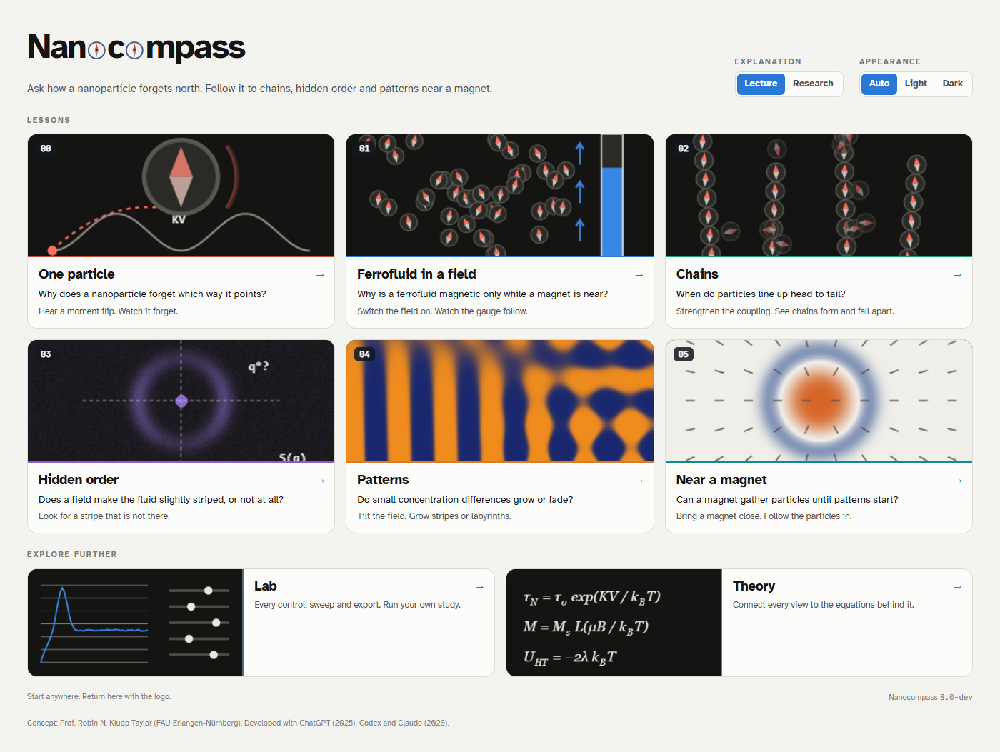

# Nanocompass

**Open the app: https://nanocompass.ipt-apps.workers.dev**

Nanocompass is a question-led teaching app about superparamagnetic nanoparticles and ferrofluids. It starts with one particle whose magnetic moment wanders at the Néel rate, then follows it to ferrofluid in a field, the magnetometer, chains and the glowing lines of a ferrocell. A Lab gives every control of the particle simulation, and a Theory page collects the physics.



Concept: Prof. Robin N. Klupp Taylor, FAU Erlangen-Nürnberg. Developed with ChatGPT (2025), Codex and Claude (2026).

## Lessons

00 One particle · 01 Ferrofluid in a field · 02 In the magnetometer · 03 Chains · 04 The ferrocell · Lab · Theory

Each lesson has a Lecture and a Research level, a guide with "Set up" tasks, and fits the window without scrolling. The app is one offline HTML file and needs nothing but a modern browser.

## Versions and addresses

| What | Where |
|---|---|
| Live version (branch `main`) | https://nanocompass.ipt-apps.workers.dev |
| Version in development (branch `dev`) | https://dev-nanocompass.ipt-apps.workers.dev |
| Released versions | [Releases](../../releases), tagged `v8.0`, `v8.1`, … |

Every change to `main` goes live within about a minute. Work happens on `dev` (or on another branch, which gets its own preview address) and is merged into `main` when it is ready for students.

## Building and testing

Requires Node.js 18 or later. No packages to install.

```
npm run build    # writes build/v8/Nanocompass_v<version>.html and build/v8/deploy/index.html
npm test         # lesson physics, magnetometer, magnet fields, ferrocell geometry
```

The hosting service runs `npm run build` itself and publishes `build/v8/deploy`. The version label shown in the app comes from `package.json`.

## Sources

| Path | Contents |
|---|---|
| `src/v8/app-shell.html`, `src/v8/styles/` | Page, start menu and lesson frame; fonts and colours |
| `src/v8/content/lessons.js` | Lesson catalogue (names, questions, slogans) |
| `src/v8/engines/planar.js` | 2D particle engine: Brownian dynamics, Néel event clock, dipoles, sterics, Metropolis sampler, pair and structure statistics |
| `src/v8/engines/magnetometer.js` | Ensemble model for M(H) loops, ZFC/FC and AC susceptibility |
| `src/v8/engines/magnet-fields.js`, `src/v8/engines/ferrocell.js` | Exact permanent-magnet fields; ferrocell twin (Keller-cone scattering by field-aligned needles, edge-lit and backlit light) |
| `src/v8/ui/` | Start menu, logo, card pictures, sliders and the lesson views |
| `src/v8/lessons/` | Lesson specifications and guides, the Lab and Theory |
| `tools/v8/build.cjs` | Build: joins the sources into one HTML file |
| `tests/v8/` | Numerical checks |

## Contributing

Suggestions and improvements are welcome: open an issue, or fork the repository and send a pull request against `dev`.

## Licence

Code and texts: MIT (see [LICENSE](LICENSE)). Embedded fonts: SIL Open Font License 1.1.
